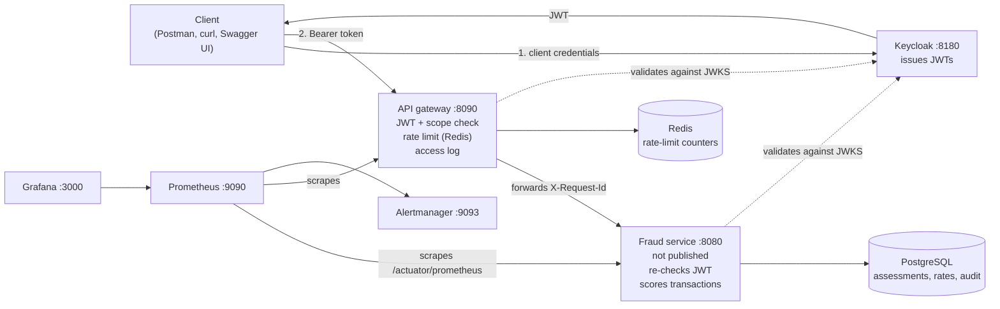
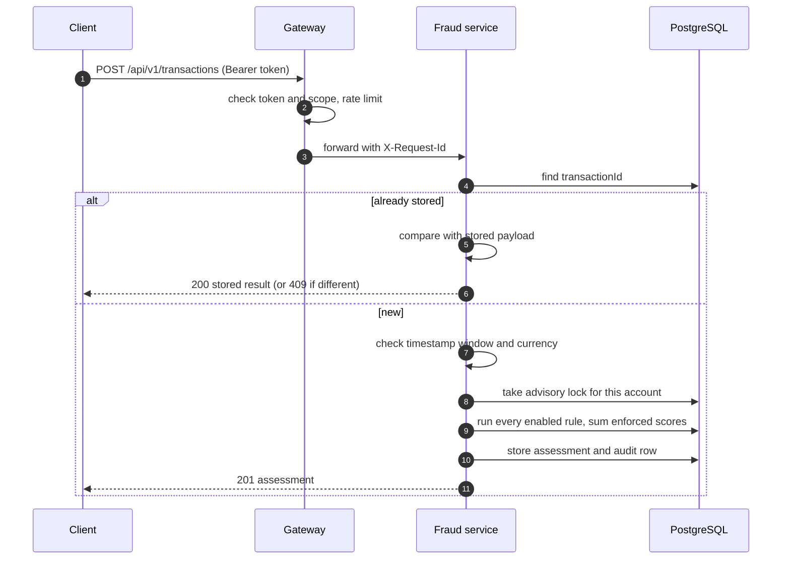
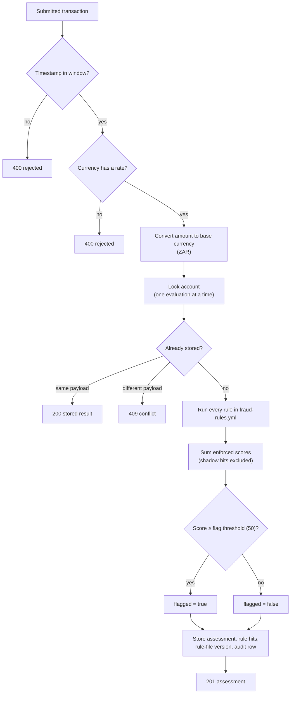
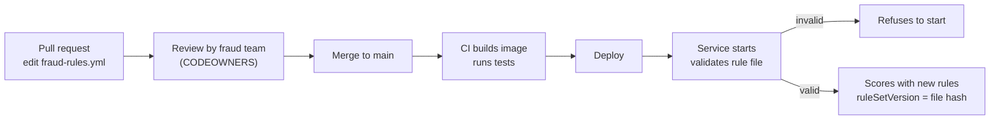
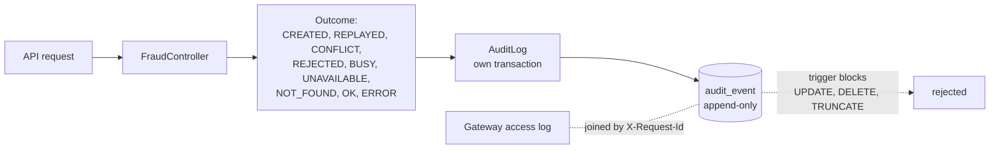

# Fraud Rule Engine

Scores each transaction against a set of fraud rules, stores the result, and exposes it through a REST API behind an
API gateway. It uses OAuth2 for authentication, rate limits per client, and keeps an audit trail of every call.

**Stack:** Java 21 · Spring Boot 4 · Spring Cloud Gateway · Spring Security (OAuth2 resource server) · Keycloak ·
PostgreSQL · Redis · Flyway · Docker Compose · Prometheus · Grafana · Testcontainers (not currently run; see
[Testing](#testing)).

> This repo bundles the gateway, monitoring and supporting services with the engine so the whole system can be reviewed
> together. In production they would live in their own repositories.

---

## Contents

1. [Architecture](#architecture)
2. [Quick start](#quick-start)
3. [Credentials](#credentials)
4. [API](#api)
5. [Fraud rules](#fraud-rules)
6. [Currencies](#currencies)
7. [Audit trail](#audit-trail)
8. [Metrics, logs and alerts](#metrics-logs-and-alerts)
9. [Testing](#testing)
10. [CI](#ci)
11. [Design decisions](#design-decisions)
12. [Known limitations](#known-limitations)

---

## Architecture



The service is reachable only through the gateway. The gateway can't reach PostgreSQL, and the service can't reach
Redis: each container sits on the Docker networks it needs and no more. Every container runs as a non-root user with
no Linux capabilities, read-only filesystems, memory limits and health checks.

### How a submission flows



---

## Quick start

You need **Docker** (Docker Desktop, or Engine with the Compose v2 plugin) and nothing else for the stack. Ports
`8090`, `8180`, `3000`, `9090`, `9093`, `5432` and `6379` must be free. Everything except the gateway is bound to
`127.0.0.1`.

**1. Create the secrets file (once)**

```powershell
.\scripts\init-env.ps1        # Windows PowerShell
```

```bash
./scripts/init-env.sh         # macOS, Linux, Git Bash, WSL
```

This creates a git-ignored `.env` with random values. Existing `.env` files are left alone. Use letters and digits
only in values, since characters such as `|`, `&` and `$` break the bootstrap step.

**2. Start**

```bash
docker compose --profile app up --build -d --wait
```

The first run builds both images and downloads dependencies, so it takes several minutes. `--wait` returns once every
container is healthy. Check with:

```bash
docker compose --profile app ps
curl http://localhost:8090/actuator/health/readiness        # {"status":"UP"}
```

**3. Stop**

```bash
docker compose --profile app down                 # stop, keep the data
docker compose --profile app down --volumes       # stop and delete the database, metrics and dashboards
```

### Changing things in `.env`

| Change | What to do |
|---|---|
| A Keycloak client secret, the scraper secret, or `KEYCLOAK_ADMIN_PASSWORD` | Restart the stack. Otherwise token requests fail with `unauthorized_client`. |
| `DB_PASSWORD` | Delete the volume (`down --volumes`). PostgreSQL applies its password only on first start. This deletes the database. |
| `GRAFANA_ADMIN_PASSWORD` | Applies only when Grafana's volume is first created. Change it in Grafana afterwards, or delete the volume. |

### Windows notes

- `curl` in Windows PowerShell is an alias for `Invoke-WebRequest`. Use `curl.exe`.
- The bash examples need Git Bash or WSL. Postman works without either.
- Tests and dev mode: `.\mvnw.cmd verify`, `.\mvnw.cmd spring-boot:run`.

---

## Credentials

Everything is generated into `.env`, so nothing secret is committed.

| Service | Address | Login | Password |
|---|---|---|---|
| API (through the gateway) | <http://localhost:8090> | Bearer token from Keycloak | client secrets below |
| Swagger UI | <http://localhost:8090/swagger-ui.html> | `docs-viewer` | `DOCS_VIEWER_PASSWORD` |
| Grafana | <http://localhost:3000> | `admin` | `GRAFANA_ADMIN_PASSWORD` |
| Keycloak admin console | <http://localhost:8180/admin> | `admin` | `KEYCLOAK_ADMIN_PASSWORD` |
| PostgreSQL (database client) | `localhost:5432`, database `fraud` | `fraud` | `DB_PASSWORD` |
| Prometheus, Alertmanager, Redis | localhost only | none | none |

API clients (Keycloak client credentials):

| Client | Secret in `.env` | Scope | Allowed |
|---|---|---|---|
| `transaction-submitter` | `TRANSACTION_SUBMITTER_SECRET` | `fraud-api/submit` | `POST /api/v1/transactions` |
| `assessment-reader` | `ASSESSMENT_READER_SECRET` | `fraud-api/read` | `GET /api/v1/assessments/**` |
| `metrics-scraper` | `METRICS_SCRAPER_SECRET` | `fraud-api/metrics` | Prometheus only |

To print one value from `.env` in PowerShell:

```powershell
(Select-String -Path .env -Pattern '^GRAFANA_ADMIN_PASSWORD=').Line.Split('=')[1]
```

---

## API

Every `/api/v1` call goes through the gateway and needs a Bearer token with the scope shown above.

| Method | Path | Scope | Result |
|---|---|---|---|
| `POST` | `/api/v1/transactions` | `fraud-api/submit` | `201` new, `200` replay, `400`, `409`, `429`, `503` |
| `GET` | `/api/v1/assessments/{transactionId}` | `fraud-api/read` | `200`, or `404` |
| `GET` | `/api/v1/assessments` | `fraud-api/read` | Search, newest first |

Search takes `flagged`, `accountId`, `from` and `to` (ISO-8601 with an offset), plus `page` (default 0, max 10,000) and
`size` (default 20, max 100).

### Submit status codes

| Code | Meaning | Client action |
|---|---|---|
| `201` | New assessment. `Location` points to it. | none |
| `200` | Identical resubmission. Stored result returned. | none |
| `400` | Bad field (named in the response), timestamp outside the window, or currency with no exchange rate | fix the request |
| `409` | Same `transactionId`, different details | investigate; do not resend |
| `429` | Too many concurrent requests for this account | retry after `Retry-After` |
| `503` | Database connection pool busy | retry after `Retry-After` |

Errors use RFC 9457 problem responses (`application/problem+json`). Every response carries an `X-Request-Id`.

### Request fields

| Field | Rule |
|---|---|
| `transactionId` | 1–64 characters: letters, digits, `.`, `_`, `-` |
| `accountId` | 1–64 characters |
| `amount` | > 0, up to 4 decimal places, and within the currency's minor units (`JPY` has none) |
| `currency` | ISO 4217, upper case. Accepted only while `exchange_rate` has a row for it |
| `category` | `GROCERIES, RESTAURANTS, TRAVEL, ENTERTAINMENT, UTILITIES, HEALTH, RETAIL, GAMBLING, CRYPTO, TRANSFER, ATM_WITHDRAWAL, OTHER` |
| `country` | ISO 3166 alpha-2, upper case |
| `timestamp` | ISO-8601 with an offset. At most 24 hours in the past and 5 minutes in the future |

### Example

```bash
NOW=$(date -u +%Y-%m-%dT%H:%M:%SZ)
curl -X POST localhost:8090/api/v1/transactions -H "Authorization: Bearer $TOKEN" \
  -H 'Content-Type: application/json' -d "{
    \"transactionId\": \"txn-1001\", \"accountId\": \"acc-42\", \"amount\": 15000.00,
    \"currency\": \"ZAR\", \"category\": \"GAMBLING\", \"merchant\": \"Casino Royale\",
    \"country\": \"ZA\", \"timestamp\": \"$NOW\"
  }"
```

### Testing with Postman

1. Import `postman/fraud-engine.postman_collection.json`.
2. In **Variables**, set `submitterClientSecret` and `readerClientSecret` from `.env`. They are empty in the file on
   purpose.
3. Run **1. Get tokens**, then **2. Fraud API**, then **3. Security checks** (expects `401` and `403`).

Tokens last 15 minutes. **Submit transaction** generates a new id once an hour, so resending within that hour is a
replay (`200`).

### Swagger UI

Open <http://localhost:8090/swagger-ui.html> and sign in as `docs-viewer`. To call the API from **Try it out**, click
**Authorize** and choose a client. The docs are for local clients; see [Known limitations](#known-limitations).

---

## Fraud rules

Rules are defined in one reviewed file, `src/main/resources/fraud-rules.yml`, not in code.



### Current rules

| Rule | Fires when | Score |
|---|---|---|
| `HIGH_AMOUNT` | amount ≥ 10,000 ZAR (converted) | 40 |
| `RISKY_CATEGORY` | category `GAMBLING` or `CRYPTO`, and amount ≥ 1,000 ZAR | 30 |
| `VELOCITY` | more than 5 assessments on the account in 10 minutes, counted by arrival time | 35 |
| `HIGH_RISK_COUNTRY` | country `KP`, `IR` or `SY` | 30 |
| `ODD_HOURS` | amount ≥ 2,000 ZAR between 00:00 and 05:00 in `Africa/Johannesburg` | 20 |

With the current scores, no single rule reaches the flag threshold of 50 (the largest is 40), so a transaction needs at least two rules to be flagged. Changing a score or the threshold can change that.

### How a rule is defined

```yaml
- code: HIGH_AMOUNT
  type: AMOUNT_THRESHOLD
  score: 40
  threshold: 10000.00
```

Five **rule types** exist in code: `AMOUNT_THRESHOLD`, `CATEGORY_AMOUNT`, `COUNTRY_LIST`, `VELOCITY` and
`ODD_HOURS`. Each takes exactly its own parameters. A missing or unexpected parameter, a duplicate code, or an
out-of-range value stops the service from starting.

### Managing rules



| Change | How |
|---|---|
| Threshold, score, category or country list | Edit `fraud-rules.yml` in a pull request |
| Add a rule of an existing type | Add an entry to `fraud-rules.yml` |
| Test a rule on live traffic without affecting flags | Set `shadow: true`. Hits are recorded and marked, but don't count toward the score. |
| Enforce a shadow rule | Remove `shadow: true` in a later pull request |
| Disable a rule | Remove it from the file. Git keeps the history. |
| New kind of logic | Add a `RuleType`, a `FraudRule` class, and a case in `RuleSetConfig.create`, with tests |

Changes take effect on the next deploy. There is no runtime override, by design: a change always goes through review.
Every assessment records the **rule-file version** (a hash of the file), so any decision can be traced to the exact
rules that produced it.

---

## Currencies

Thresholds are in one base currency (`fraud.base-currency`, ZAR by default). Every other currency is converted with a
rate in the `exchange_rate` table before the rules run. A currency is accepted only while it has a row there.

```sql
-- Accept USD (1 USD = 18.50 ZAR), or update its rate
INSERT INTO exchange_rate (currency, rate_to_base) VALUES ('USD', 18.50)
ON CONFLICT (currency) DO UPDATE SET rate_to_base = EXCLUDED.rate_to_base, updated_at = now();

-- Stop accepting USD
DELETE FROM exchange_rate WHERE currency = 'USD';
```

- Adding or retiring a currency needs no redeploy.
- Each assessment stores `baseAmount` and `rateToBase`, so a stored result can be audited after rates change.
- Rates are maintained by hand. The service doesn't fetch a market feed, so keeping them current is an operational task.

---

## Audit trail

Every submit, read and search is recorded in the `audit_event` table.



| Column | Meaning |
|---|---|
| `actor` | The calling client (the token's `azp`, for example `transaction-submitter`) |
| `action` | `SUBMIT`, `READ` or `SEARCH` |
| `resource_id` | Transaction id, for submit and read |
| `outcome` | What happened (see diagram) |
| `request_id` | Matches the `X-Request-Id` header and the gateway's log line |
| `detail` | For example `score=70 flagged=true` or the search filters |

To trace one transaction:

```sql
SELECT occurred_at, actor, action, outcome, request_id, detail
FROM audit_event WHERE resource_id = 'txn-1001' ORDER BY id;
```

Each entry commits in its own transaction, so rejected requests are recorded. If an entry can't be written, the
request fails rather than going unrecorded. Rows can't be updated, deleted or truncated, because a database trigger
rejects those statements (migration `V6`).

**Limits:** the actor is the calling application, not the person behind it, because client-credentials tokens identify
systems. Requests rejected by bean validation (a malformed body) are not audited. The application's database user
should not own the table, or it could drop the trigger.

---

## Metrics, logs and alerts

`docker compose --profile app up` starts Prometheus and Grafana. The **Fraud Rule Engine** dashboard is Grafana's home
page.

| Metric | What it tells you |
|---|---|
| `fraud_submissions_total{outcome}` | `assessed`, `duplicate`, `conflict`, `account_busy` |
| `fraud_assessments_total{flagged}` | Verdicts, for the flag rate |
| `fraud_rule_hits_total{rule}` | How often each rule fires |
| `fraud_risk_score` | Score distribution |
| `fraud_evaluation_seconds` | Evaluation time, including waiting for the account lock |
| `http_server_requests_seconds` | Request rate, status and latency |
| `hikaricp_connections_*`, `jvm_*` | Database pool, memory, GC and CPU |

Tags never include account or transaction ids, since those are customer data and would create a time series each.

**Logs** are one JSON object per line (Elastic Common Schema). Account ids are masked to their last four characters.
Logs never contain tokens, secrets or request bodies. To follow one request, search the logs for its `X-Request-Id`:

```bash
docker compose logs -f app gateway
```

**Alerts** are defined in `infra/prometheus/alerts.yml`:

| Alert | Severity | Fires when |
|---|---|---|
| `FraudServiceDown` | critical | an app can't be scraped for 1 minute |
| `GatewayHighErrorRate` | critical | over 5% of gateway responses are 5xx for 5 minutes |
| `GatewayHighLatency` | warning | gateway p95 is over 1 s for 10 minutes |
| `AccountBusySpike` | warning | more than 10 account-busy rejections in 5 minutes |
| `FlagRateUnusual` | warning | over 30% of new assessments flagged for 15 minutes |
| `EdgeAuthRejectionsHigh` | warning | more than 1 request/s rejected with 401/403 for 10 minutes |
| `DatabaseConnectionsWaiting` | warning | requests wait for a database connection for 5 minutes |
| `JvmHeapHigh` | warning | old-generation heap over 90% for 10 minutes |

Alertmanager doesn't notify anyone until a receiver (Slack, email, PagerDuty) is configured in
`infra/alertmanager/alertmanager.yml`.

---

## Testing

| Layer | What runs | Command |
|---|---|---|
| Unit (service) | Rules and their boundaries, rule-file validation, currency conversion, replay ordering, audit outcomes, request-id filter, API mapping | `./mvnw verify` |
| Unit (gateway) | Access log, request ids, client ids | `./mvnw -f gateway/pom.xml verify` |
| Alert rules | Prometheus rule tests | `promtool test rules` (run in CI) |
| End to end | Whole Compose stack plus the Postman collection through Newman | CI |

```bash
./mvnw verify                               # fraud service unit tests (Windows: .\mvnw.cmd verify)
./mvnw -f gateway/pom.xml verify            # gateway unit tests
```

The service has **no automated test against a real PostgreSQL**. Migrations, schema validation, the account lock under
concurrent load and the search queries are not exercised by any test in this repository. The Testcontainers integration
test was removed; restoring it is the most valuable testing addition.

---

## CI

GitHub Actions (`.github/workflows/ci.yml`):

- Unit tests for both services, and the Prometheus alert-rule tests
- Image build and a Trivy vulnerability scan for both images (fails on fixable HIGH and CRITICAL)
- A Trivy misconfiguration scan of the Dockerfiles
- End to end: the whole stack, with the Postman collection run through Newman

Dependabot keeps Maven, Docker, Compose and Actions dependencies current. Actions are pinned to commit SHAs.

---

## Design decisions

| Decision | Why |
|---|---|
| Rules in a reviewed file, not a database | Every change goes through a pull request and CODEOWNERS review, with history in git. A change takes a deploy rather than a minute, which is the trade-off. |
| Startup validation of the rule file | An invalid rule set stops the service instead of running with missing checks. |
| Base currency plus exchange rates | One threshold means the same thing in every currency, and rates can change without a deploy. |
| Idempotent submits, keyed on `transactionId` | Retries are safe. A reused id with different details is a visible `409`, not silently ignored. |
| Replays answered before intake checks | A retry after the timestamp window still gets the stored result. |
| Per-account advisory lock | Concurrent requests for one account are evaluated in order, so a burst can't slip past the velocity limit. |
| Velocity counts arrival time | A client can't evade the limit by sending old timestamps. |
| Append-only audit trail with a database trigger | Rows can't be changed through the application, and the database enforces it. |
| Gateway and service both check the token | The service stays protected even if something reaches it without the gateway. |

**Concurrency detail:** a request waiting on an account lock holds a database connection. The pool is capped
(`DB_POOL_SIZE`, default 20), and a request that can't get a connection within 2 s gets `503`. This limits how far one
hot account can slow others, but a burst on one account still uses connections that others could have used.

**Migrations:** `V2` is a plain `CREATE INDEX`. On a large production table, build
`idx_assessment_account_evaluated` by hand with `CREATE INDEX CONCURRENTLY` before deploying, since `V2` uses
`IF NOT EXISTS` and will then skip it. Flyway can't run `CONCURRENTLY` safely here, because the build waits on Flyway's
own open transaction.

**Tracing:** the gateway's `X-Request-Id` is reused by the service and written to every log line and every audit row.

---

## Known limitations

- **Security:**
  - Keycloak runs in development mode (embedded database, realm re-imported on start). A real deployment needs
    production-mode Keycloak and secrets from a vault. Secrets come from a git-ignored `.env`.
  - Traffic between containers is plain HTTP. There is no TLS inside the stack.
  - Tokens are not checked for an audience (`aud`). Any token from the realm with the right scope is accepted.
  - "Try it out" in Swagger asks for a client secret in the browser. Production docs should use user sign-in (authorization code with PKCE).
  - The `fraud-api/read` scope can read every account's assessments. There is no per-account authorization yet.
  - The Swagger login session lives in the gateway's memory, so it doesn't survive a restart or work across replicas.
- **Operations:**
  - One instance of each service. Compose restarts failed containers but doesn't do rolling deploys.
  - If Redis is unavailable, the gateway's rate limiter fails open (requests are allowed).
  - Alertmanager has no notification channel. Grafana uses a local admin account.
  - Base images are pinned by tag, not by digest.
- **Data and audit:**
  - No retention policy. Account and merchant data is stored in full.
  - The audit actor is the calling application, not the end user.
  - Requests rejected by bean validation are not audited.
- **Testing:** no automated test against a real PostgreSQL, and no load test or penetration test.
- **Scoring:** transactions are scored once, when they arrive. An assessed transaction is never re-scored when rules change.
