# Flows

How requests, data and background behaviour move through the fraud engine. The README covers setup, the
API reference and the rule list; this file covers what happens inside each flow, in order.

Contents

1. [Components and networks](#1-components-and-networks)
2. [Authentication and authorization](#2-authentication-and-authorization)
3. [Submit a transaction](#3-submit-a-transaction)
4. [Replay, conflict and concurrency](#4-replay-conflict-and-concurrency)
5. [Rule evaluation and scoring](#5-rule-evaluation-and-scoring)
6. [Read assessments](#6-read-assessments)
7. [Request IDs and access logs](#7-request-ids-and-access-logs)
8. [Errors](#8-errors)
9. [Time handling (UTC)](#9-time-handling-utc)
10. [Data model](#10-data-model)
11. [Swagger UI and API docs login](#11-swagger-ui-and-api-docs-login)
12. [Metrics, alerts and health](#12-metrics-alerts-and-health)
13. [Startup and deployment](#13-startup-and-deployment)
14. [Known gaps found while documenting](#14-known-gaps-found-while-documenting)

---

## 1. Components and networks

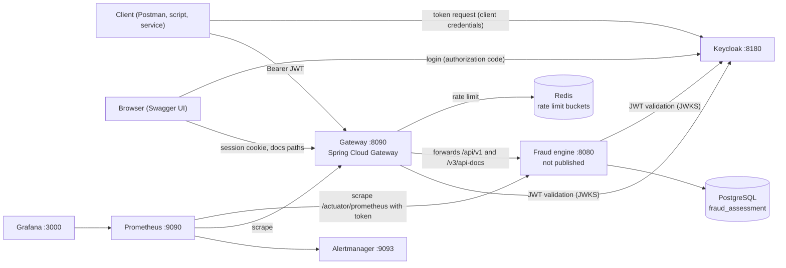

Docker networks: the gateway sits on `edge`, `backend` and `cache`. The engine sits on `backend` and `data`. Only
the engine can reach PostgreSQL, and only the gateway can reach Redis. The engine has no published port.

## 2. Authentication and authorization

Three Keycloak clients, one per job. Each client's scopes come from the realm in `infra/keycloak/fraud-engine-realm.json`.

| Client | Grant | Scope | Used for |
|---|---|---|---|
| `transaction-submitter` | client credentials | `fraud-api/submit` | `POST /api/v1/transactions` |
| `assessment-reader` | client credentials | `fraud-api/read` | `GET /api/v1/assessments/**` |
| `metrics-scraper` | client credentials | `fraud-api/metrics` | `GET /actuator/prometheus` |
| `fraud-docs` | authorization code (browser) | none | Swagger UI login only |

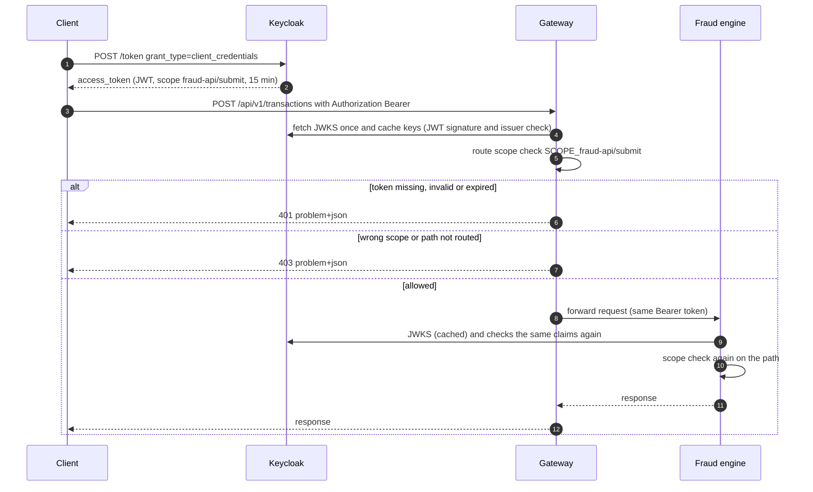

Rules that matter here:

- **Two checks by design.** The gateway enforces token and scope at the edge. The engine checks them again, so it
  stays protected if something reaches it without going through the gateway.
- **Stateless.** Both services use `SessionCreationPolicy.STATELESS` (engine) and `NoOpServerSecurityContextRepository`
  (gateway API chain). A Bearer token is required on every call.
- **No CSRF.** CSRF is disabled on the API chains because they accept only Bearer tokens, never cookies. The docs
  chain is the only one that uses a session cookie.
- **Client ID for logs and rate limits.** `ClientIds.of` takes the `azp` claim, falls back to `client_id`, then to the
  principal name. That value is both the rate-limit key and the `clientId` log field.

## 3. Submit a transaction

`POST /api/v1/transactions`, scope `fraud-api/submit`. Success codes are `201` (new), `200` (identical replay).

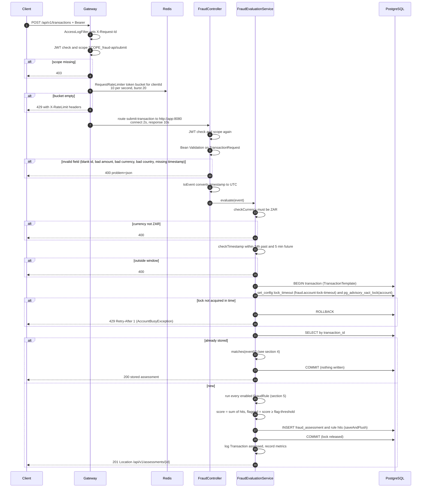

Step notes:

1. **Gateway first.** Auth and rate limiting happen before the engine does any work, so a flood of bad requests is
   cut off at the edge. The rate limit is per client, not per IP.
2. **Bean validation** (`TransactionRequest`): `transactionId` and `accountId` are required, at most 64 characters.
   `amount` is > 0 with at most 15 integer and 4 fraction digits. `currency` matches `ZAR`, `country` matches `[A-Z]{2}`,
   `category` must be a known enum value, `merchant` is at most 128 characters, and `timestamp` must be present.
3. **Currency and timestamp checks run before the lock**, so an invalid request never takes a database lock.
4. **The lock is per account.** `pg_advisory_xact_lock` is held until the transaction commits. Requests for the same
   account run one at a time, which keeps the velocity count accurate. Different accounts do not block each other.
5. **The lock timeout is short** (`fraud.account-lock-timeout`, default 1s). A request that can't get the lock fails fast
   with `429` instead of holding a connection while it queues.
6. **Nothing is written on a replay**, so the stored assessment is returned unchanged even if the rules have since changed.
7. **Everything for a new assessment is one database transaction.** Rules, score, insert and the lock all happen inside it.

## 4. Replay, conflict and concurrency

A `transactionId` is the primary key of `fraud_assessment`, so each id is assessed at most once.

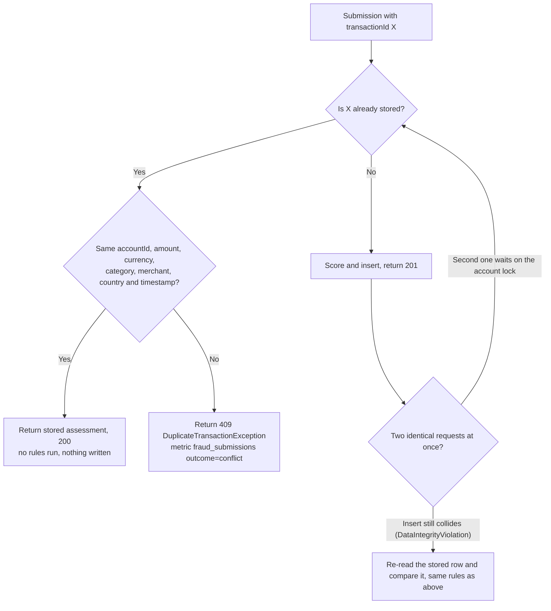

Details:

- **Comparison** (`FraudAssessment.matches`) compares every field a client sends, with the timestamp truncated to
  microseconds to match what is stored. Amounts compare with `compareTo`, so `10.0` and `10.0000` are equal.
  The timestamp comparison uses `isEqual`, which compares instants.
- **`merchant` is null-safe.** A missing merchant in both submissions matches.
- **Concurrent duplicates** are serialized by the account lock, so the second request sees the first one's row. The
  `DataIntegrityViolation` catch in `FraudEvaluationService.evaluate` is a fallback for a race the lock does not cover.
  It re-reads the stored row, then applies the same match or conflict check.
- **Timestamp changes count as conflicts.** A resubmission with the same id but a different timestamp returns `409`.

## 5. Rule evaluation and scoring

The rules come from `src/main/resources/fraud-rules.yml`, loaded once at startup into a `RuleSet` together with a hash of
that file (`ruleSetVersion`). Each rule implements `FraudRule.evaluate(EvaluationContext) : Optional<RuleHit>`. A rule
marked `shadow: true` is recorded but doesn't count toward the score. An invalid file stops the service from starting.

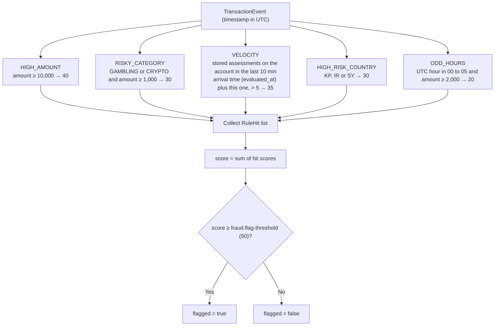

Points worth knowing:

- **Each rule's result is independent.** No rule reads another rule's output, so you can add or disable one without
  changing the others.
- **Velocity uses arrival time**, not the client's timestamp. `evaluated_at` is set by the server. A client can't avoid
  the limit by sending backdated timestamps.
- **The count is for the account only**, and only includes assessments that are already stored. The account lock makes
  this consistent.
- **A flagged transaction is still saved and returned as `201`.** `flagged` is a verdict on the record. The engine doesn't
  block or hold anything. Whatever acts on the verdict is outside this service.
- **Rule order does not matter.** The result is a sum, so the same hits always produce the same score.

## 6. Read assessments

Both endpoints need scope `fraud-api/read` at the gateway and in the engine. Responses are not cached.

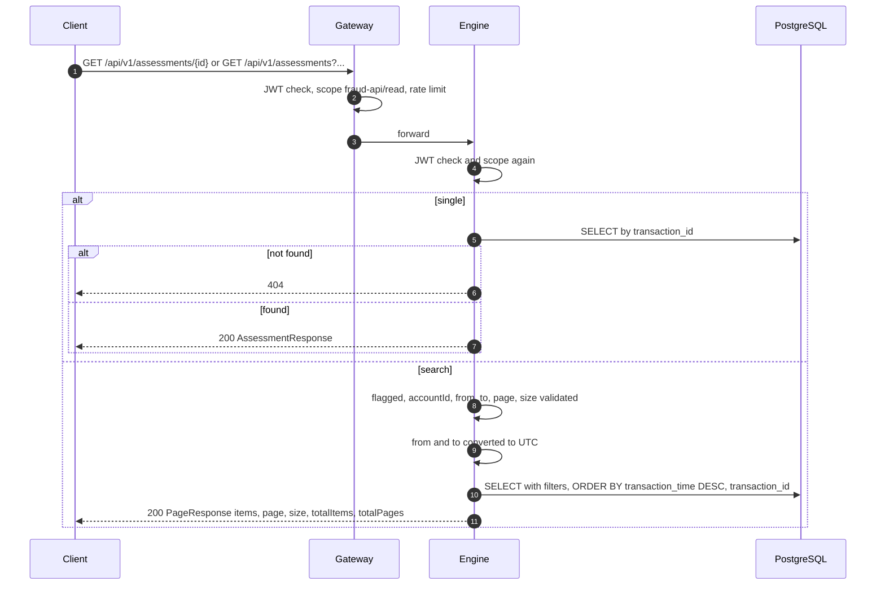

Search rules:

- `from` is inclusive and `to` is exclusive. Both filter on `transaction_time`, which is the time of the transaction,
  not the time it was assessed.
- Both are `OffsetDateTime`. Any offset is accepted and converted to UTC before the query.
- `page` is 0 to 10,000. `size` is 1 to 100 (default 20).
- Sorting is newest first, with `transaction_id` as a tie-breaker so paging is stable.
- The indexes that cover these queries are `(account_id, transaction_time)`, `(flagged, transaction_time)` and
  `(account_id, evaluated_at)` for the velocity count.

## 7. Request IDs and access logs

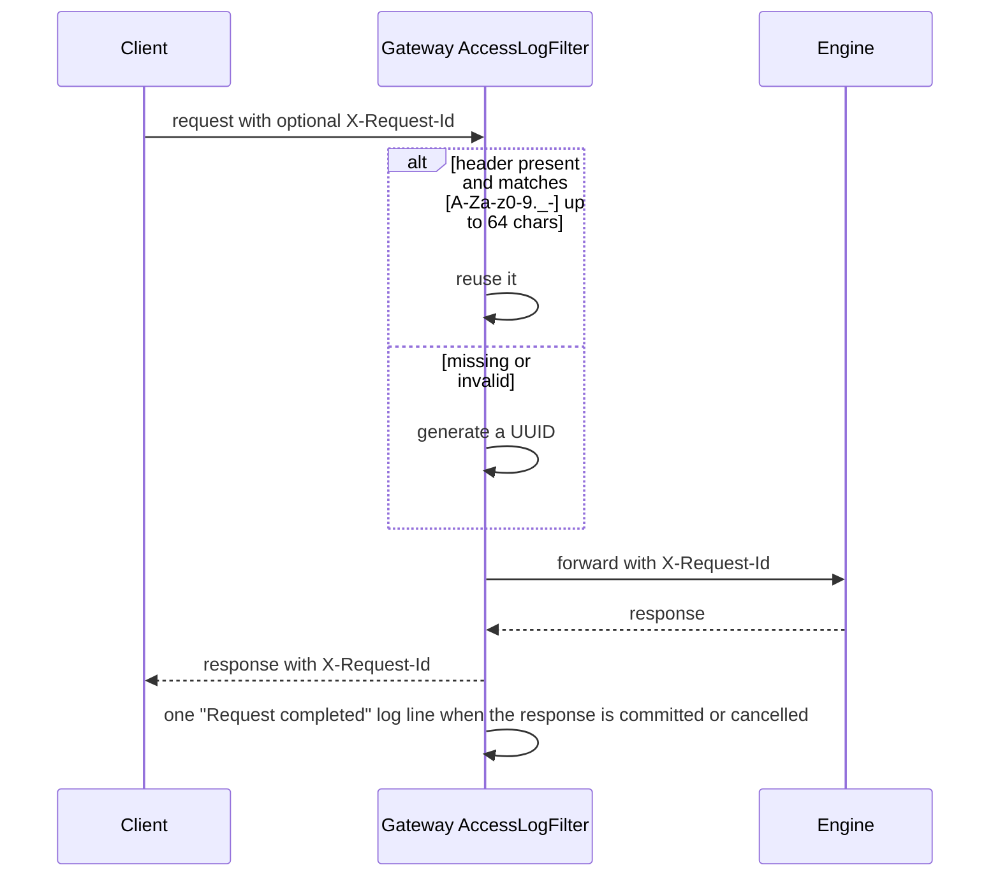

- The gateway logs one line per request with `requestId`, `clientId`, `method`, `path` (no query string), `status` and
  `durationMs`.
- The engine logs `Transaction assessed` for each new assessment with `transactionId`, the masked `accountId`
  (`****7890`), `riskScore`, `flagged` and the rule codes. Replays and conflicts log a warning only for conflicts.
- Logs are ECS JSON on stdout. Tokens, secrets and request bodies are never logged.

## 8. Errors

Every error is an RFC 9457 `application/problem+json` response.

| Status | Who returns it | When |
|---|---|---|
| `400` | Engine | Bean validation fails, currency is not ZAR, timestamp is outside the window |
| `400` | Spring | Malformed JSON, or a bad `from`/`to` value (`ResponseEntityExceptionHandler`) |
| `401` | Gateway | Missing, invalid or expired token |
| `403` | Gateway or engine | Token lacks the scope for this route, or the path is not routed |
| `404` | Engine | No assessment with that transaction id |
| `409` | Engine | Same transaction id with different details |
| `429` | Gateway | Rate limit for this client exceeded (`X-RateLimit-*` headers) |
| `429` | Engine | Account lock not acquired within `fraud.account-lock-timeout` (`Retry-After: 1`) |
| `500` | Engine | Anything unexpected. The message is generic and the stack trace is logged |
| `502`/`504` | Gateway | Engine unreachable or slow (`connect-timeout` 2s, `response-timeout` 10s). Not handled specially |

`ApiExceptionHandler` maps the four domain exceptions and falls back to a generic `500`.

## 9. Time handling (UTC)

Every date-time in the system is an `OffsetDateTime` in UTC.

| Where | Field | Notes |
|---|---|---|
| Request body | `timestamp` | Accepted with any offset, converted to UTC by `TransactionEvent`. Send `Z` to avoid confusion |
| Domain | `TransactionEvent.timestamp` | Always UTC (normalized in the record's constructor) |
| Entity | `FraudAssessment.transactionTime` | Stored as `timestamptz`, read back as UTC (`hibernate.jdbc.time_zone: UTC`) |
| Entity | `FraudAssessment.evaluatedAt` | Set from the `Clock`, always UTC |
| Response | `timestamp`, `evaluatedAt` | ISO-8601 with `Z` |
| Query | `from`, `to` | Any offset, converted to UTC before the query |
| Rule logic | `OddHoursRule` hour, `VelocityRule` window | Use the UTC values directly |

Two places use time without a date type: `Clock` (injected, `Clock.systemUTC()` in `AppConfig`) and `Duration`
settings (`fraud.timestamp.max-age`, `max-future-skew`, `account-lock-timeout`, velocity `window`).

## 10. Data model

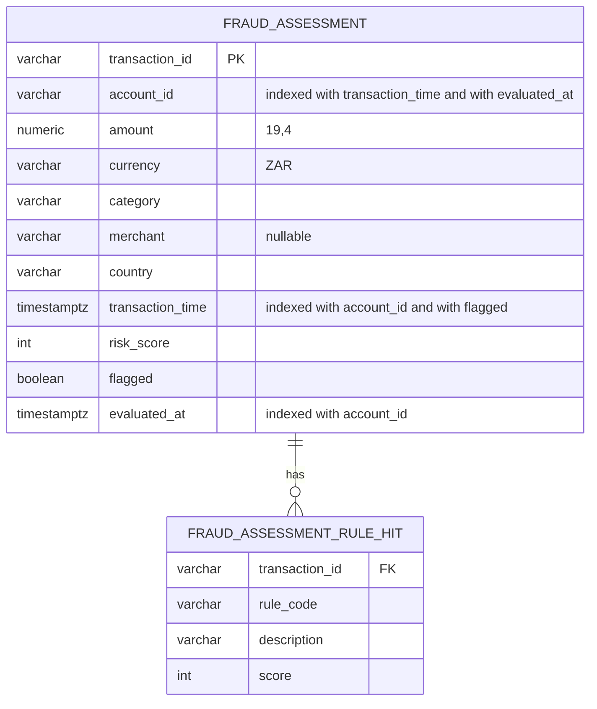

- Flyway runs `V1__create_fraud_assessment.sql` and `V2__index_assessment_by_arrival_time.sql`.
- Hibernate runs with `ddl-auto: validate`, so the entity and the schema must match.
- Rule hits are an element collection loaded eagerly with the assessment (batch size 100).
- Rows are never updated or deleted by the application. Each assessment is written once.

## 11. Swagger UI and API docs login

The docs are served through the gateway, so they use a browser login (authorization code flow, client `fraud-docs`),
separate from the API's Bearer tokens.

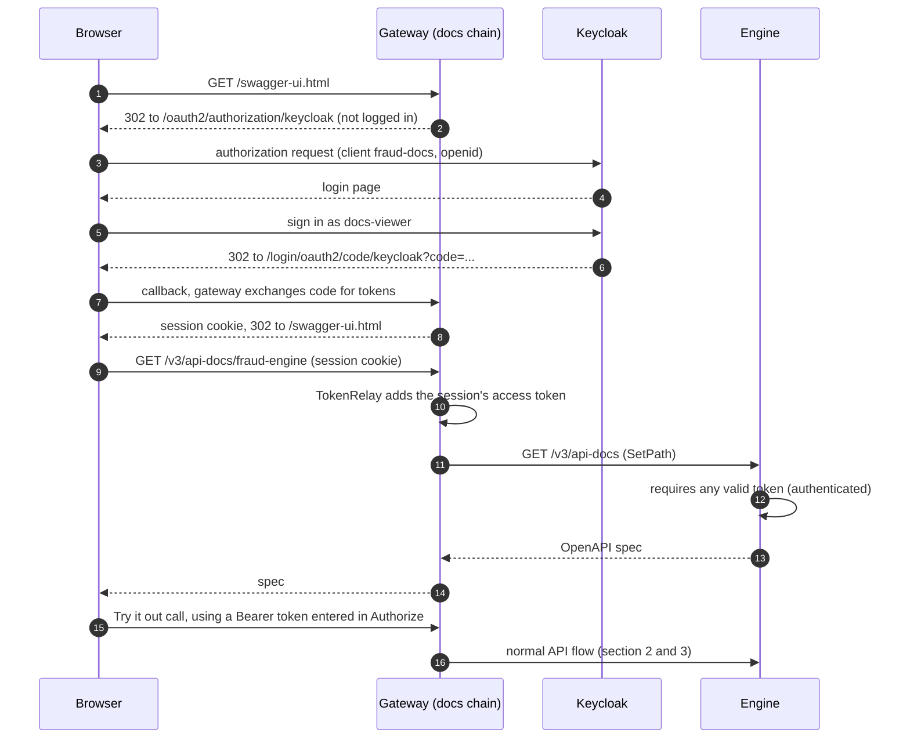

- The **session** is only on the docs paths (`/swagger-ui/**`, `/v3/api-docs/**`, `/login/**`, and a few others). The API
  chain is stateless, so a logged-in browser can't call the API without a Bearer token.
- **Try it out** uses a client the user picks in the Authorize dialog (`assessment-reader` or `transaction-submitter`).
  Swagger UI fetches that token from Keycloak itself.
- The sign-in session is held in the gateway's memory. A restart logs everyone out, and two gateway replicas would not
  share sessions.

## 12. Metrics, alerts and health

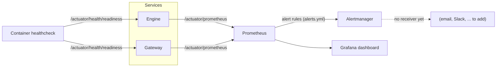

- **Metrics** the engine records (`FraudMetrics`): `fraud.submissions{outcome}` (`assessed`, `duplicate`, `conflict`,
  `account_busy`), `fraud.assessments{flagged}`, `fraud.rule.hits{rule}`, `fraud.risk.score`, `fraud.evaluation` (timer,
  includes lock wait).
- **Scraping** uses the `metrics-scraper` client. Prometheus fetches a token from Keycloak and refreshes it when it expires.
- **Health**: `/actuator/health/readiness` is public. The engine's actuator endpoints are not routed by the gateway.
- **Alerts** are listed in the README. The ones tied to flows are `AccountBusySpike` (section 3, lock timeouts),
  `FlagRateUnusual` (section 5 verdicts), `EdgeAuthRejectionsHigh` (section 2 failures), `GatewayHighErrorRate` and
  `DatabaseConnectionsWaiting`.

## 13. Startup and deployment

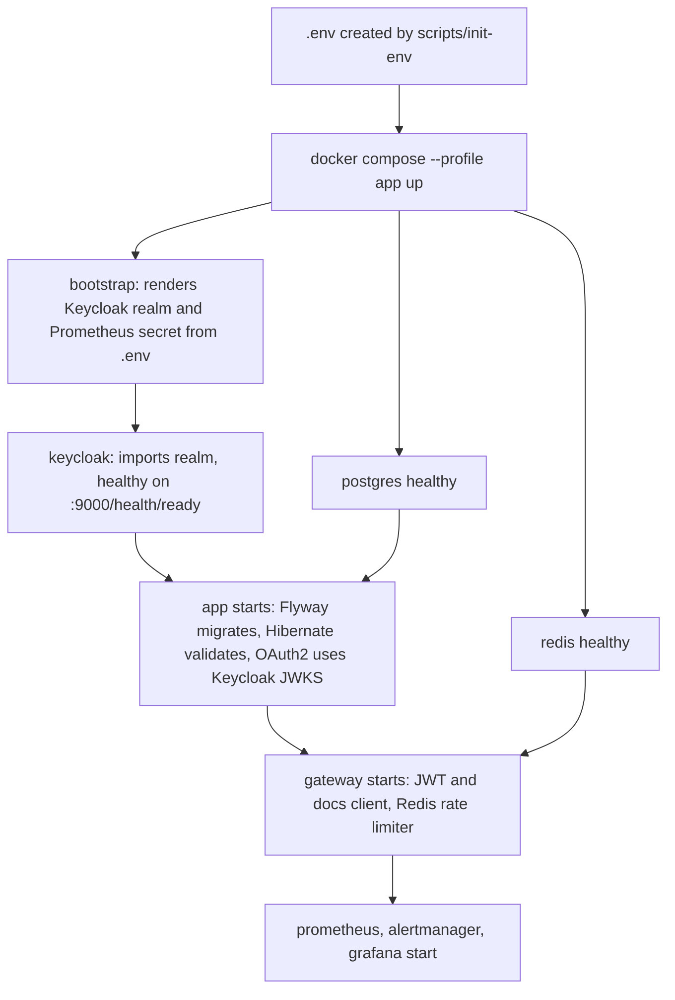

- Each container runs as non-root with `cap_drop: ALL`, `no-new-privileges`, a read-only filesystem and memory limits.
- Secrets come from `.env`. The bootstrap container writes the rendered realm and the scraper secret into shared
  volumes, so secrets never sit in the repo.
- Changing a Keycloak or metrics secret needs a restart (`docker compose down`, then `up`). Changing `DB_PASSWORD` needs `docker compose down --volumes`, because PostgreSQL sets its password only when its data volume is first created.
- CI runs the unit and integration tests, image builds and scans, and an end-to-end run of the Compose stack with Newman
  (this covers the HTTP and security paths in sections 2, 3 and 6).

## 14. Known gaps found while documenting

These come from reading the code for this document. None of them is fixed here.

1. **Docs chain and Bearer tokens.** The gateway's docs chain (`/v3/api-docs/**` included) uses only `oauth2Login`
   and no resource server. A script that sends a Bearer token to `/v3/api-docs/**` through the gateway would be
   redirected to login rather than served. This is what the SecurityConfig suggests; I haven't tested it against a
   running stack.
2. **Rate limiter fails open.** If Redis is down, the gateway lets requests through (README, known limitations).
3. **Gateway timeouts have no custom handling.** An engine that is slow or down returns a generic gateway error.
   There is no retry, circuit breaker or problem response from the gateway for this case.
4. **Velocity depends on stored history only.** A transaction is counted only after it has been assessed. That is
   correct for this service, but it means a transaction never submitted here is invisible to the rule.
5. **Flagged transactions are not blocked.** Whatever uses the verdict is outside this service.
6. **Replays don't re-score.** A replay returns the original assessment, even after a rule change.
7. **No per-account authorization.** Any `fraud-api/read` client can read any account's assessments.
8. **Session-based docs login is in memory**, so it does not survive a restart or work across gateway replicas.
